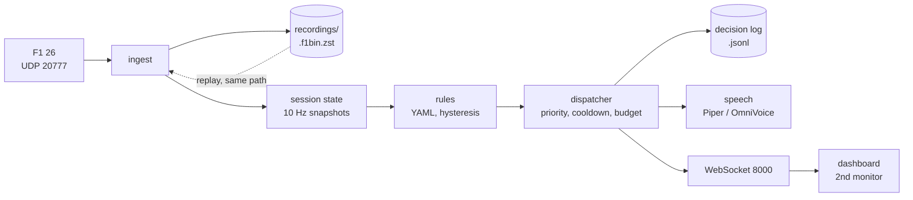

# f1-pitwall

A race engineer for F1 26. It reads the game's UDP telemetry, keeps a model of
the session, decides what is worth saying, says it over your headset, and shows
it on a second monitor. Pitwall runs on your local network. Nothing leaves it.

- **Status and known gaps:** [docs/status.md](docs/status.md)
- **Docs site:** https://artsworks.github.io/f1-pitwall/
- **Lessons from live sessions (ADRs):** [docs/adr/](docs/adr/README.md)

## Quick start

Install on a Windows PC with PowerShell:

```powershell
irm https://raw.githubusercontent.com/artsworks/f1-pitwall/main/install/install.ps1 | iex
```

Install on a Mac or Linux server:

```sh
curl -LsSf https://raw.githubusercontent.com/artsworks/f1-pitwall/main/install/install.sh | sh
```

[Read the install guide](https://pitwall.arthurku.com/install.html).

Mac and Linux servers play speech in the dashboard browser tab only.

Set the game's UDP telemetry, then open `http://localhost:8000` on the second
monitor. The dashboard goes LIVE when you are on track. Update with the Pitwall
Update shortcut, or run `pitwall update`.

[docs/getting-started.md](docs/getting-started.md) has the manual installation, the
game settings, the voice download and troubleshooting.

### Wheel buttons

In the game's controls menu, bind a free wheel button to **UDP Action 1**. A single
press acknowledges the last call, a double press is a negative, and a hold of 2 s
turns radio silent on or off. [docs/12-driver-input.md](docs/12-driver-input.md)
lists every input.

## What it says today

| Call | When |
|---|---|
| Qualifying | Clean-air release, abort advice, and a push/cool/box/push-now run plan with fuel and battery reminders |
| Race strategy | Plans A/B/C, pit windows, undercut and overcut advice, and safety-car or VSC stop calls |
| Tyres | Out-lap checks, thermal advice, and life from the minimum of worst-corner wear life and the pace cliff |
| Fuel and ERS | Fuel margin, deployment and energy-budget calls |
| Driving and flags | Wing damage, boost left on, yellow flags, lock-ups, spins and slides |

Calls rotate through several phrasings, and repeat the same mistake often
enough and the engineer gets drier about it (ADR 0008).

Every call is a rule in [`src/pitwall/config/defaults/rules/shared.yaml`](src/pitwall/config/defaults/rules/shared.yaml)
with thresholds in [`thresholds.yaml`](src/pitwall/config/defaults/thresholds.yaml).

### After a session

No steps are required. Pitwall grades sessions at the end and runs upkeep at the next
start. Optional review and learning commands are in
[After a session](docs/getting-started.md#after-a-session).

### Learning loop

Pitwall grades each session when it ends, then refits its track priors and adjusts
rule cooldowns. Your grades override automatic ones, and rule thresholds change only
after you review them. [docs/20-learning-loop.md](docs/20-learning-loop.md) has the
details and explains how to
[contribute your learned values](docs/20-learning-loop.md#contributing-your-learnings).

## Shape of the system



Recordings replay through the same ingest → state → rules path, so every rule
is tuned and tested offline against real sessions instead of by driving another race.

## Recording and replay

Pitwall records every session under `recordings/`, which stays local and git-ignored.
`pitwall replay` runs a recording through the same pipeline as a live session.
[docs/07-replay-and-debug.md](docs/07-replay-and-debug.md) has the details.

## Commands

| Command | What it does | Example |
|---|---|---|
| `pitwall start` | Run live: listens to game telemetry, makes calls, speaks them. | `pitwall start` |
| `pitwall doctor` | Check your setup: tests the UDP port and shows which telemetry arrives. | `pitwall doctor --seconds 10` |
| `pitwall update` | Update Pitwall: pull the latest code with git, then sync dependencies with uv. | `pitwall update` |
| `pitwall replay` | Rerun a recording through the engine to see the calls it makes. | `pitwall replay latest --speed 4 --serve` |
| `pitwall voice` | Manage speech: list and download voices, pre-render phrases, test audio. | `pitwall voice say "Box this lap"` |
| `pitwall debrief` | Export a session debrief as one HTML file you can open or share. | `pitwall debrief` |

Run `pitwall --help` to list every command and `pitwall <command> -h` for its options
and an example. Run `pitwall --help-all` to list the advanced commands for rule-engine
work: `diff`, `bench`, `rules check`, `propose`, `tune`, `restore` and `trim`.

## Why it is not just another dashboard

Gauges are a solved problem. The value here is judgement: knowing that the
undercut is worth 1.2 seconds, that there are three laps of life left in the
fronts at this pace, and, above all, knowing when to stay silent.

- **Record and replay.** Strategy logic is tuned offline against recordings.
- **Rules as data.** Each call is a declarative rule with its own hysteresis,
  cooldown and phrasing, so tuning is a config edit and every rule has a replay test.
- **A mindset you set.** Balanced or aggressive: one control that biases pit
  windows, energy, tyre management and which rival it watches.

## Documents

**Use**

| Document | Contents |
|---|---|
| [`docs/status.md`](docs/status.md) | What works today, what is next, known gaps |
| [`docs/getting-started.md`](docs/getting-started.md) | Install, game settings, after-session commands, recording profiles, replay, troubleshooting |
| [`docs/07-replay-and-debug.md`](docs/07-replay-and-debug.md) | Recording format, replay CLI, A/B diffing, live diagnostics |
| [`docs/08-configuration.md`](docs/08-configuration.md) | Settings model, verbosity presets, balanced/aggressive mindset |
| [`docs/20-learning-loop.md`](docs/20-learning-loop.md) | Automatic grading and upkeep, calibration, learned state |
| [`docs/25-report-analysis-prompt.md`](docs/25-report-analysis-prompt.md) | Prompt that turns a `pitwall report` zip with bookmarks into issues, fixes and regression tests |

**Design**

| Document | Contents |
|---|---|
| [`docs/01-architecture.md`](docs/01-architecture.md) | Layers, stack, cross-cutting decisions, repo layout |
| [`docs/02-ingestion.md`](docs/02-ingestion.md) | Packets consumed, parser design, pause/flashback, recording format |
| [`docs/03-strategy.md`](docs/03-strategy.md) | Rule format, pace and degradation model, pit loss, race and quali calls |
| [`docs/04-audio-ui.md`](docs/04-audio-ui.md) | Priorities, suppression, speech constraints, WebSocket protocol |
| [`docs/09-performance.md`](docs/09-performance.md) | Co-hosting with the game: stutter causes, budget, measurement |
| [`docs/12-driver-input.md`](docs/12-driver-input.md) | Wheel button and spacebar: acknowledge / negative |
| [`docs/13-league-multiplayer.md`](docs/13-league-multiplayer.md) | Friends-league target: restricted telemetry, league preset |
| [`docs/15-dashboard-design.md`](docs/15-dashboard-design.md) | Second-monitor dashboard design, v3 (implemented in `web/`) |
| [`docs/16-debrief-design.md`](docs/16-debrief-design.md) | Session debrief: built sections, grading and deferred work |
| [`docs/17-quali-run-plan.md`](docs/17-quali-run-plan.md) | Qualifying run plan and coaching |
| [`docs/18-race-engine.md`](docs/18-race-engine.md) | Race engine, tyre life, degradation priors and persistence |
| [`docs/19-guest-tower.md`](docs/19-guest-tower.md) | Guest timing tower at `/tower` for spectators (design only, not built) |
| [`docs/21-voice-command.md`](docs/21-voice-command.md) | Voice-command design and implementation status |
| [`docs/22-setup-advisor.md`](docs/22-setup-advisor.md) | Setup advisor proposal: parameter effects, parc fermé matrix, balance signals, rule tables, learning loop |
| [`docs/23-synthetic-recordings.md`](docs/23-synthetic-recordings.md) | Spike: synthetic recordings from real sessions as rule-learning scenarios |
| [`docs/24-scenario-bench.md`](docs/24-scenario-bench.md) | `pitwall bench`: replay scenarios, score the calls, compare with a baseline |
| [`docs/26-driver-rating.md`](docs/26-driver-rating.md) | Driver rating from 0 to 1: components and where it appears |

**Decisions and reference**

| Document | Contents |
|---|---|
| [`docs/adr/`](docs/adr/README.md) | Architecture decision records: what live sessions taught us |
| [`docs/05-roadmap.md`](docs/05-roadmap.md) | Next work and later options; the finished M0–M4 plan as history |
| [`docs/reference/f1-26-udp-notes.md`](docs/reference/f1-26-udp-notes.md) | Verified format-2026 packet facts |
| [`docs/research/`](docs/research/) | Research notes: lift and coast, penalty escalation, race end and formation lap, safety-car restart, team orders, track limits, weather crossover |
| [`docs/versioning.md`](docs/versioning.md) | Semantic Versioning, PR title rules and the release workflow |
| [`docs/00-review-of-v1.md`](docs/00-review-of-v1.md), [`06`](docs/06-direction-changes.md), [`10`](docs/10-angles-not-yet-considered.md), [`11`](docs/11-open-questions.md), [`14`](docs/14-adversarial-review.md) | History / early planning (kept for reference): review of the first plan, direction changes, open angles and questions, adversarial review |

## Licence

GPLv3 — see [`LICENSE`](LICENSE).

## Disclaimer

f1-pitwall is an unofficial project for education and experiments. It is not affiliated with, endorsed by or connected to Formula 1, the FIA or the makers of the F1 games. Formula 1, F1 and related marks are trademarks of their owners. The tool reads the game's UDP telemetry on your own PC. Development and tests use previously recorded and synthetic timing and telemetry data.
